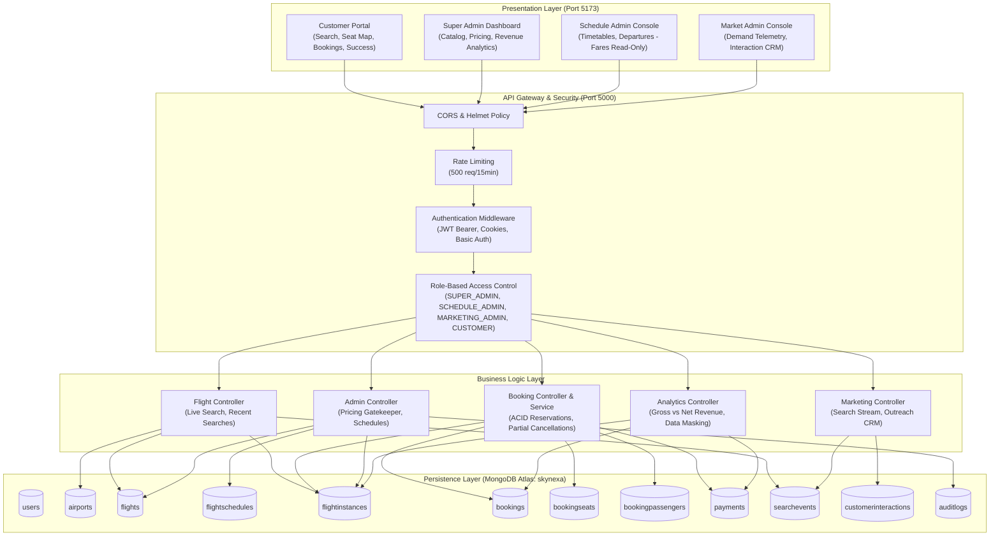

<a id="top"></a>
<div align="center">


### ✈️ Complete Flight Booking Engine
**Production-grade, full-stack airline reservation and operations platform**


<br><br>

<table align="center" width="100%">
<tr>
<td align="center" width="25%"><h2>30</h2><sub><b>Airports</b></sub></td>
<td align="center" width="25%"><h2>4</h2><sub><b>User Roles</b></sub></td>
<td align="center" width="25%"><h2>13</h2><sub><b>Collections</b></sub></td>
<td align="center" width="25%"><h2>49 / 49</h2><sub><b>Tests Passing</b></sub></td>
</tr>
</table>

<a href="#181-project-overview">Overview</a> ·
<a href="#185-installation-guide">Install</a> ·
<a href="#188-run-locally">Run</a> ·
<a href="#1811-rest-api-documentation">API</a> ·
<a href="#1813-automated-testing--verification">Tests</a> ·
<a href="#1816-live-interview-demonstration-scenarios">Demo</a>

</div>


## 📑 Table of Contents

<table width="100%">
<tr>
<td valign="top" width="50%">

1. [18.1 Project Overview](#181-project-overview)
2. [18.2 Technology Stack](#182-technology-stack)
3. [18.3 Architecture & System Design](#183-architecture--system-design)
4. [18.4 Prerequisites](#184-prerequisites)
5. [18.5 Installation Guide](#185-installation-guide)
6. [18.6 Environment Variables](#186-environment-variables)
7. [18.7 Database Setup & Atlas Integration](#187-database-setup--atlas-integration)
8. [18.8 Run Locally](#188-run-locally)

</td>
<td valign="top" width="50%">

9. [18.9 Sample Development Data](#189-sample-development-data)
10. [18.10 Database Relationships, Foreign Keys & Schema Tables](#1810-database-relationships-foreign-keys--schema-tables)
11. [18.11 REST API Documentation](#1811-rest-api-documentation)
12. [18.12 Core Business Rules & Invariants](#1812-core-business-rules--invariants)
13. [18.13 Automated Testing & Verification](#1813-automated-testing--verification)
14. [18.14 Assumptions & Technical Limitations](#1814-assumptions--technical-limitations)
15. [18.15 Troubleshooting & FAQs](#1815-troubleshooting--faqs)
16. [18.16 Live Interview Demonstration Scenarios](#1816-live-interview-demonstration-scenarios)

</td>
</tr>
</table>

> [!TIP]
> **⚡ Quick start** (after creating your `.env` files, see [18.6](#186-environment-variables))
> ```bash
> npm run install:all
> node backend/src/scripts/ensureMasterData.js
> node backend/src/scripts/seedAdmins.js
> cd backend  && npm run dev     # API  → http://localhost:5000
> cd frontend && npm run dev     # UI   → http://localhost:5173
> ```


## 18.1 Project Overview
**Skynexa** is an enterprise-grade commercial airline flight reservation engine and fleet management system. It provides four distinct, authenticated operational roles:

1. **Customer**: Search live scheduled departures across 30 airports, view real-time adult and child fares, choose seats interactively on visual cabin layouts, validate government identity numbers (Aadhaar), complete payments via verified demo card/UPI adapters, manage itineraries, trigger partial or full cancellations with automated refund calculation, and review search history with one-click "Search Again".
2. **Super Admin**: Master authority over the commercial flight catalog, routes, aircraft specifications, visual cabin layout designer, adult and child pricing policies, system-wide financial analytics (gross booking value vs. net realized revenue), customer manifest reporting, and immutable audit logs.
3. **Schedule Admin**: Operational authority over one-time and recurring timetables, flight departure instances, and capacity management. **All fare-editing controls have been strictly revoked** (direct API attempts return `HTTP 403 Forbidden`).
4. **Market Admin**: Route demand and commercial analytics dashboard displaying search telemetry, unmet demand (zero-match routes), and customer interaction CRM logging (outreach channel, status, follow-up notes).

<div align="right"><a href="#top">⬆ back to top</a></div>


## 18.2 Technology Stack

### Frontend Client
- **Framework**: React 19 (`react` ^19.3.1, `react-dom` ^19.3.1)
- **Bundler & Dev Server**: Vite 8 (`vite` ^8.3.0)
- **Routing**: React Router v7 (`react-router-dom` ^7.18.4)
- **Styling**: Tailwind CSS v3 (`tailwindcss` ^3.4.19, `postcss` ^8.5.30, `autoprefixer` ^10.6.1)
- **Icons**: Lucide React (`lucide-react` ^1.57.0)
- **Date Formatting**: `date-fns` ^4.4.0
- **HTTP Client**: Axios (`axios` ^1.20.0) configured with base URLs and credential exchange
- **Feedback**: React Hot Toast (`react-hot-toast` ^2.6.1)

### Backend Server
- **Runtime Environment**: Node.js (v18.x / v20.x LTS)
- **Web Application Framework**: Express.js (`express` ^4.18.2)
- **Database Driver & ODM**: Mongoose (`mongoose` ^8.0.3)
- **Security & Hardening**: Helmet (`helmet` ^7.1.0), CORS (`cors` ^2.8.5), Express Rate Limit (`express-rate-limit` ^7.1.5)
- **Authentication**: JSON Web Tokens (`jsonwebtoken` ^9.0.2), Bcrypt (`bcryptjs` ^2.4.3), Cookie Parser (`cookie-parser` ^1.4.6)
- **Validation**: Express Validator (`express-validator` ^7.0.1)
- **Transactional Emails**: Resend API (`resend` ^2.0.0)

### Database
- **Engine**: MongoDB Atlas (Cloud Replica Set)
- **Database Name**: `skynexa`
- **ACID Support**: Multi-document transactions used for bookings, seat assignments, and cancellations

<div align="right"><a href="#top">⬆ back to top</a></div>
```javascript
const resend = new Resend(process.env.RESEND_API_KEY);
```


## 18.3 Architecture & System Design



<div align="right"><a href="#top">⬆ back to top</a></div>


## 18.4 Prerequisites
- **Node.js**: v18.16.0 or higher (v20+ LTS recommended)
- **Package Manager**: npm v9+ (or yarn / pnpm)
- **MongoDB Atlas**: An active MongoDB Atlas cluster connection string (`mongodb+srv://...`)
- **Web Browser**: Chrome, Firefox, Edge, or Safari with JavaScript enabled

<div align="right"><a href="#top">⬆ back to top</a></div>


## 18.5 Installation Guide

### Step 1: Clone or Open Workspace
```bash
cd "e:\Flight Booking Engine"
```

### Step 2: Install Backend Dependencies
```bash
cd backend
npm install
cd ..
```

### Step 3: Install Frontend Dependencies
```bash
cd frontend
npm install
cd ..
```

> [!TIP]
> Prefer one command? Install both packages from the repo root:
> ```bash
> npm run install:all
> ```

<div align="right"><a href="#top">⬆ back to top</a></div>


## 18.6 Environment Variables

Copy the provided `.env.example` templates to active `.env` files:

### Backend Configuration (`backend/.env`)
```env
NODE_ENV=development
PORT=5000
CLIENT_URL=http://localhost:5173

# MongoDB Atlas connection string
MONGODB_URI=mongodb+srv://<db_user>:<db_password>@<cluster>.mongodb.net/skynexa

# JWT Auth Secret
JWT_SECRET=<long-random-secret>
JWT_EXPIRE=7d

# Resend Transactional Email API Key
RESEND_API_KEY=<your_resend_api_key>
EMAIL_FROM=onboarding@resend.dev
```

### Frontend Configuration (`frontend/.env`)
```env
VITE_API_BASE_URL=http://localhost:5000/api
```

> [!IMPORTANT]
> Client environment variables must use the `VITE_` prefix. Never place MongoDB credentials or JWT private secrets in the frontend `.env`.

> [!WARNING]
> Replace every `<placeholder>` with your own value, keep all `.env` files in `.gitignore`, and never commit real credentials.

<div align="right"><a href="#top">⬆ back to top</a></div>


## 18.7 Database Setup & Atlas Integration

The system connects automatically to the `skynexa` database on MongoDB Atlas.
1. The backend tests the connection at startup in `backend/src/server.js` using `mongoose.connect(process.env.MONGODB_URI)`.
2. Mongoose automatically builds required indexes:
   - Unique: `users.email`, `users.username`, `airports.code`, `flights.flightNumber`, `bookings.bookingReference`, `payments.transactionId`.
   - Compound: `{ flightId: 1, departureDateTime: 1 }`, `{ flightInstanceId: 1, seatNumber: 1, status: 1 }`.
   - Telemetry: `{ userId: 1, createdAt: -1 }`, `{ eventType: 1, createdAt: -1 }`.

<div align="right"><a href="#top">⬆ back to top</a></div>


## 18.8 Run Locally

### Terminal 1: Start Backend Server
```bash
cd backend
npm run dev
```
> [!NOTE]
> Backend runs on `http://localhost:5000` (Nodemon auto-reloads on edits).

### Terminal 2: Start Frontend Application
```bash
cd frontend
npm run dev
```
> [!NOTE]
> Frontend runs on `http://localhost:5173` with Vite HMR.

<div align="right"><a href="#top">⬆ back to top</a></div>


## 18.9 Sample Development Data

To safely seed master airports, initial aircraft layouts, commercial flights, and admin accounts into MongoDB without deleting existing booking history:

```bash
# Seed initial airports and 6 master flights
node backend/src/scripts/ensureMasterData.js

# Ensure standard role accounts exist
node backend/src/scripts/seedAdmins.js
```

### Documented Staff & Demo Credentials

| Role               | Email Address                | Password              | Permissions Scope                                                                       |
| :----------------- | :--------------------------- | :-------------------- | :-------------------------------------------------------------------------------------- |
| **Super Admin**    | `superadmin@skynexa.com`     | `SuperAdmin@2026`     | Master flight catalog, visual layouts, adult/child fares, revenue analytics, audit logs |
| **Schedule Admin** | `scheduleadmin@skynexa.com`  | `ScheduleAdmin@2026`  | Flight timetables, departures. **Pricing edits blocked (HTTP 403)**                     |
| **Market Admin**   | `marketingadmin@skynexa.com` | `MarketingAdmin@2026` | Demand telemetry, zero-match searches, customer interaction CRM                         |
| **Customer**       | `jestin@skynexa.com`         | `Password@123`        | Flight search, booking, seat selection, partial/full cancellations                      |

<div align="right"><a href="#top">⬆ back to top</a></div>


## 18.10 Database Relationships, Foreign Keys & Schema Tables

Skynexa employs a normalized MongoDB architecture using Mongoose `ObjectId` references (`ref`) to guarantee relational integrity, paired with embedded immutable snapshots for financial and seat-state audits.

For the visual diagram and formal ER specifications, see [docs/DATABASE.md](docs/DATABASE.md).

<div align="right"><a href="#top">⬆ back to top</a></div>


### Master Foreign Key & Relationship Matrix

The table below explains every foreign key, referenced collection, multiplicity, and cascading/concurrency behavior across the system:

| Source Collection & Field            | Key Type | References Target (`PK`) | Cardinality | Cascading & Concurrency Rules                                             | Business Purpose in Skynexa                                       |
| :----------------------------------- | :------: | :----------------------- | :---------: | :------------------------------------------------------------------------ | :---------------------------------------------------------------- |
| `flights.originAirportId`            |  **FK**  | `airports._id`           |   $N : 1$   | Restrict: Airport cannot be deleted if active flights depart from it      | Defines origin departure airport node                             |
| `flights.destinationAirportId`       |  **FK**  | `airports._id`           |   $N : 1$   | Restrict: Airport cannot be deleted if active flights land at it          | Defines destination arrival airport node                          |
| `flights.aircraftLayoutId`           |  **FK**  | `aircraftlayouts._id`    |   $N : 1$   | Restrict: Layout required to compute rows, columns, and capacity          | Links flight to physical cabin layout and seat letters            |
| `flightschedules.flightId`           |  **FK**  | `flights._id`            |   $N : 1$   | Cascade deactivate: Deactivating flight stops recurring timetable         | Connects timetable rule to master commercial flight callsign      |
| `flightinstances.flightId`           |  **FK**  | `flights._id`            |   $N : 1$   | Immutable link: Preserves flight callsign and airport route endpoints     | Associates physical daily departure with commercial route         |
| `flightinstances.scheduleId`         |  **FK**  | `flightschedules._id`    |   $N : 1$   | Set null or retain: Tracks generating schedule rule                       | Audits which recurring timetable rule created this departure      |
| `bookings.userId`                    |  **FK**  | `users._id`              |   $N : 1$   | Strict Ownership: Queries filter by `userId`; unauthorized access blocked | Connects customer account to reservation and ticket               |
| `bookings.flightInstanceId`          |  **FK**  | `flightinstances._id`    |   $N : 1$   | Inventory Lock: Decrements `bookedCount` via atomic `$inc`                | Links reservation to specific physical flight departure           |
| `bookings.offerId`                   |  **FK**  | `offers._id`             |   $N : 1$   | Optional Nullable: Populated only when valid promo code applied           | Tracks promotional coupon applied to reservation                  |
| `bookingpassengers.bookingId`        |  **FK**  | `bookings._id`           |   $N : 1$   | Cascade Cancel: Cancelling booking updates all linked passenger statuses  | Associates individual traveler manifest with PNR                  |
| `bookingseats.flightInstanceId`      |  **FK**  | `flightinstances._id`    |   $N : 1$   | Concurrency Lock: Compound unique index prevents double booking           | Enforces seat uniqueness per physical flight departure            |
| `bookingseats.bookingId`             |  **FK**  | `bookings._id`           |   $N : 1$   | Partial Release: Released seats marked `RELEASED` while booking remains   | Links seat allocation to customer reservation                     |
| `bookingseats.passengerId`           |  **FK**  | `bookingpassengers._id`  |   $1 : 1$   | Individual assignment: Passenger holds exactly one active seat            | Maps specific seat number (e.g. `12A`) to legal passenger         |
| `payments.bookingId`                 |  **FK**  | `bookings._id`           |   $N : 1$   | Financial Receipt: Idempotent transaction reference                       | Stores transaction log and settlement status for booking          |
| `payments.userId`                    |  **FK**  | `users._id`              |   $N : 1$   | Audit tracking: Tracks payer identity                                     | Associates payment transaction with customer                      |
| `searchevents.userId`                |  **FK**  | `users._id`              |   $N : 1$   | Optional Nullable: Populated for authenticated searches, null for guests  | Powers customer "Search Again" and Market Admin telemetry         |
| `searchevents.originAirportId`       |  **FK**  | `airports._id`           |   $N : 1$   | Route Resolution: Resolves 3-letter IATA code to city/name                | Connects search query to departure airport                        |
| `searchevents.destinationAirportId`  |  **FK**  | `airports._id`           |   $N : 1$   | Route Resolution: Resolves destination IATA code                          | Connects search query to arrival airport                          |
| `customerinteractions.userId`        |  **FK**  | `users._id`              |   $N : 1$   | CRM Profile: Identifies contacted customer                                | Links staff interaction log to customer profile                   |
| `customerinteractions.searchEventId` |  **FK**  | `searchevents._id`       |   $N : 1$   | Demand Context: Links outreach note to specific customer search query     | Contextualizes staff outreach with search criteria                |
| `customerinteractions.marketAdminId` |  **FK**  | `users._id`              |   $N : 1$   | Staff Attribution: Tracks Market Admin staff member                       | Records which Market Admin performed customer follow-up           |
| `auditlogs.userId`                   |  **FK**  | `users._id`              |   $N : 1$   | Non-repudiation: Immutable record of administrator action                 | Identifies user responsible for sensitive administrative mutation |
| `auditlogs.entityId`                 |  **FK**  | Polymorphic              |   $N : 1$   | Dynamic Target: References `flights._id`, `bookings._id`, etc.            | Links audit log entry to the modified entity                      |
| `notifications.userId`               |  **FK**  | `users._id`              |   $N : 1$   | In-App Inbox: Pushed to user notification list                            | Directs alerts to target customer or administrator                |
| `supporttickets.userId`              |  **FK**  | `users._id`              |   $N : 1$   | Customer Support: Links ticket to customer account                        | Links AI Concierge chat/inquiry to customer profile               |
| `supporttickets.bookingId`           |  **FK**  | `bookings._id`           |   $N : 1$   | Optional Nullable: Populated when inquiry pertains to specific PNR        | Links support conversation to specific flight reservation         |

<div align="right"><a href="#top">⬆ back to top</a></div>


### Comprehensive Collection Schema Tables

#### 1. `users` Collection
| Field Name                   | Type       | Key / Constraint | Foreign Reference | Description                                                    |
| :--------------------------- | :--------- | :--------------- | :---------------- | :------------------------------------------------------------- |
| `_id`                        | `ObjectId` | **PK**           | —                 | Unique internal MongoDB identifier                             |
| `username`                   | `String`   | **UK**, Required | —                 | Unique handle (lowercase, trimmed, min 3 chars)                |
| `email`                      | `String`   | **UK**, Required | —                 | Unique verified email address (lowercase, trimmed)             |
| `passwordHash`               | `String`   | Required         | —                 | Salted bcrypt password hash (salt rounds: 12)                  |
| `role`                       | `String`   | Required, Enum   | —                 | `CUSTOMER`, `SCHEDULE_ADMIN`, `MARKETING_ADMIN`, `SUPER_ADMIN` |
| `status`                     | `String`   | Enum             | —                 | `ACTIVE`, `INACTIVE` (default: `ACTIVE`)                       |
| `firstName`                  | `String`   | Optional         | —                 | Customer / staff legal first name                              |
| `lastName`                   | `String`   | Optional         | —                 | Customer / staff legal last name                               |
| `phone`                      | `String`   | Optional         | —                 | Contact telephone number                                       |
| `identityVerificationStatus` | `String`   | Enum             | —                 | `NOT_VERIFIED`, `PENDING`, `VERIFIED`                          |
| `createdAt` / `updatedAt`    | `Date`     | Timestamp        | —                 | Mongoose automatic lifecycle timestamps                        |

#### 2. `airports` Collection
| Field Name | Type       | Key / Constraint          | Foreign Reference | Description                                            |
| :--------- | :--------- | :------------------------ | :---------------- | :----------------------------------------------------- |
| `_id`      | `ObjectId` | **PK**                    | —                 | Unique internal airport identifier                     |
| `code`     | `String`   | **UK**, Required          | —                 | 3-letter IATA airport code (e.g., `DEL`, `BOM`, `MAA`) |
| `name`     | `String`   | Required                  | —                 | Full official airport name                             |
| `city`     | `String`   | Required, Indexed         | —                 | City served by airport                                 |
| `country`  | `String`   | Default: `'India'`        | —                 | Country location                                       |
| `timezone` | `String`   | Default: `'Asia/Kolkata'` | —                 | Airport local timezone string                          |
| `active`   | `Boolean`  | Default: `true`           | —                 | Operational status toggle                              |

#### 3. `aircraftlayouts` Collection
| Field Name      | Type       | Key / Constraint | Foreign Reference | Description                                                |
| :-------------- | :--------- | :--------------- | :---------------- | :--------------------------------------------------------- |
| `_id`           | `ObjectId` | **PK**           | —                 | Unique internal layout identifier                          |
| `name`          | `String`   | Required         | —                 | Layout name (e.g., `Airbus A320neo 180Y Standard`)         |
| `type`          | `String`   | Required         | —                 | Aircraft ICAO code (e.g., `A320`, `B737`, `E190`)          |
| `capacity`      | `Number`   | Required, min: 1 | —                 | Total passenger seating capacity                           |
| `rows`          | `Number`   | Required         | —                 | Total rows in passenger cabin                              |
| `seatsPerRow`   | `Number`   | Required         | —                 | Seats per row (e.g. 6 for 3-3 aisle configuration)         |
| `configuration` | `Object`   | Optional         | —                 | Coordinate matrix containing row letters (`A`–`F`) & exits |

#### 4. `flights` Collection (Master Catalog)
| Field Name             | Type       | Key / Constraint | Foreign Reference     | Description                                                |
| :--------------------- | :--------- | :--------------- | :-------------------- | :--------------------------------------------------------- |
| `_id`                  | `ObjectId` | **PK**           | —                     | Unique internal flight identifier                          |
| `flightNumber`         | `String`   | **UK**, Required | —                     | Commercial flight callsign (e.g., `SK-101`, `SK-204`)      |
| `flightName`           | `String`   | Required         | —                     | Commercial route name (e.g., `Capital Corridor`)           |
| `originAirportId`      | `ObjectId` | **FK**, Required | `airports._id`        | Departure airport reference                                |
| `destinationAirportId` | `ObjectId` | **FK**, Required | `airports._id`        | Arrival destination airport reference                      |
| `aircraftLayoutId`     | `ObjectId` | **FK**, Required | `aircraftlayouts._id` | Cabin seating configuration reference                      |
| `baseFare`             | `Number`   | Required, min: 0 | —                     | Default base fare in INR (**Super Admin Managed**)         |
| `adultFare`            | `Number`   | Required, min: 0 | —                     | Default adult ticket fare in INR (**Super Admin Managed**) |
| `childFare`            | `Number`   | Required, min: 0 | —                     | Default child ticket fare in INR (**Super Admin Managed**) |
| `active`               | `Boolean`  | Default: `true`  | —                     | Commercial route operational toggle                        |

#### 5. `flightschedules` Collection
| Field Name      | Type       | Key / Constraint | Foreign Reference | Description                                      |
| :-------------- | :--------- | :--------------- | :---------------- | :----------------------------------------------- |
| `_id`           | `ObjectId` | **PK**           | —                 | Unique internal schedule identifier              |
| `flightId`      | `ObjectId` | **FK**, Required | `flights._id`     | Associated master flight callsign reference      |
| `scheduleType`  | `String`   | Enum             | —                 | `DAILY`, `WEEKLY`, `CUSTOM`                      |
| `daysOfWeek`    | `[Number]` | Array (0–6)      | —                 | Operating days array (0=Sun, 1=Mon, ..., 6=Sat)  |
| `departureTime` | `String`   | Required         | —                 | Standard departure time in IST (e.g., `'06:00'`) |
| `arrivalTime`   | `String`   | Required         | —                 | Standard arrival time in IST (e.g., `'07:15'`)   |
| `validFrom`     | `Date`     | Required         | —                 | Schedule commencement date                       |
| `validTo`       | `Date`     | Required         | —                 | Schedule expiration date                         |
| `active`        | `Boolean`  | Default: `true`  | —                 | Active timetable toggle                          |

#### 6. `flightinstances` Collection (Physical Departures)
| Field Name          | Type       | Key / Constraint  | Foreign Reference     | Description                                        |
| :------------------ | :--------- | :---------------- | :-------------------- | :------------------------------------------------- |
| `_id`               | `ObjectId` | **PK**            | —                     | Unique departure instance identifier               |
| `flightId`          | `ObjectId` | **FK**, Required  | `flights._id`         | Master commercial flight reference                 |
| `scheduleId`        | `ObjectId` | **FK**, Optional  | `flightschedules._id` | Generating recurring schedule reference            |
| `departureDateTime` | `Date`     | Required, Indexed | —                     | Full ISO departure timestamp in UTC                |
| `arrivalDateTime`   | `Date`     | Required          | —                     | Full ISO arrival timestamp in UTC                  |
| `travelDate`        | `Date`     | Required, Indexed | —                     | Departure calendar date normalized to midnight UTC |
| `status`            | `String`   | Enum              | —                     | `SCHEDULED`, `ON_TIME`, `DELAYED`, `CANCELLED`     |
| `capacity`          | `Number`   | Required, min: 1  | —                     | Total physical seats available on aircraft         |
| `bookedCount`       | `Number`   | Default: 0        | —                     | Current confirmed booked passenger count           |
| `adultFare`         | `Number`   | Required          | —                     | Departure-specific adult fare in INR               |
| `childFare`         | `Number`   | Required          | —                     | Departure-specific child fare in INR               |
| *`availableSeats`*  | `Virtual`  | Computed          | —                     | Dynamically evaluated as `capacity - bookedCount`  |

#### 7. `bookings` Collection
| Field Name           | Type       | Key / Constraint | Foreign Reference     | Description                                                                                                  |
| :------------------- | :--------- | :--------------- | :-------------------- | :----------------------------------------------------------------------------------------------------------- |
| `_id`                | `ObjectId` | **PK**           | —                     | Unique internal booking identifier                                                                           |
| `bookingReference`   | `String`   | **UK**, Required | —                     | Unique PNR alphanumeric code (e.g., `SKY-2026-X8Y7Z`)                                                        |
| `userId`             | `ObjectId` | **FK**, Required | `users._id`           | Customer account who owns this reservation                                                                   |
| `flightInstanceId`   | `ObjectId` | **FK**, Required | `flightinstances._id` | Specific physical flight departure reserved                                                                  |
| `status`             | `String`   | Enum             | —                     | `PENDING`, `CONFIRMED`, `PARTIALLY_CANCELLED`, `CANCELLED`                                                   |
| `paymentStatus`      | `String`   | Enum             | —                     | `PENDING`, `PAID`, `FAILED`, `REFUNDED`                                                                      |
| `paymentId`          | `ObjectId` | **FK**, Optional | `payments._id`        | Linked payment transaction reference                                                                         |
| `passengerCount`     | `Number`   | Required, min: 0 | —                     | Total active confirmed travelers on booking                                                                  |
| `adultCount`         | `Number`   | Required, min: 0 | —                     | Active adult travelers                                                                                       |
| `childCount`         | `Number`   | Required, min: 0 | —                     | Active child travelers                                                                                       |
| `adultFare`          | `Number`   | **Snapshot**     | —                     | Immutable adult fare snapshot at time of booking                                                             |
| `childFare`          | `Number`   | **Snapshot**     | —                     | Immutable child fare snapshot at time of booking                                                             |
| `subtotal`           | `Number`   | **Snapshot**     | —                     | Base ticket price snapshot ($N_{\text{adult}} \times \text{fare}_A + N_{\text{child}} \times \text{fare}_C$) |
| `taxAmount`          | `Number`   | **Snapshot**     | —                     | Preserved 12% GST and airport development charges                                                            |
| `discountAmount`     | `Number`   | Default: 0       | —                     | Applied promotional discount amount                                                                          |
| `totalAmount`        | `Number`   | Required, min: 0 | —                     | Net payable / paid booking total                                                                             |
| `refundAmount`       | `Number`   | Default: 0       | —                     | Cumulative refund credited following cancellations                                                           |
| `cancellationReason` | `String`   | Optional         | —                     | Reason provided by customer/admin for cancellation                                                           |
| `cancelledAt`        | `Date`     | Optional         | —                     | Timestamp when cancellation was committed                                                                    |

#### 8. `bookingpassengers` Collection
| Field Name      | Type       | Key / Constraint | Foreign Reference | Description                                         |
| :-------------- | :--------- | :--------------- | :---------------- | :-------------------------------------------------- |
| `_id`           | `ObjectId` | **PK**           | —                 | Unique internal passenger identifier                |
| `bookingId`     | `ObjectId` | **FK**, Required | `bookings._id`    | Parent reservation PNR reference                    |
| `firstName`     | `String`   | Required         | —                 | Traveler legal first name                           |
| `lastName`      | `String`   | Required         | —                 | Traveler legal last name                            |
| `age`           | `Number`   | Required, min: 0 | —                 | Traveler age in years                               |
| `gender`        | `String`   | Enum             | —                 | `MALE`, `FEMALE`, `OTHER`                           |
| `type`          | `String`   | Enum             | —                 | `ADULT`, `CHILD`, `INFANT`                          |
| `aadhaarNumber` | `String`   | Required         | —                 | Government ID (masked in views to `XXXX-XXXX-1234`) |
| `seatNumber`    | `String`   | Optional         | —                 | Assigned seat coordinate code (e.g., `'14B'`)       |
| `status`        | `String`   | Enum             | —                 | `CONFIRMED`, `CANCELLED` (default: `CONFIRMED`)     |
| `cancelledAt`   | `Date`     | Optional         | —                 | Timestamp if passenger was cancelled                |

#### 9. `bookingseats` Collection
| Field Name         | Type       | Key / Constraint | Foreign Reference       | Description                                |
| :----------------- | :--------- | :--------------- | :---------------------- | :----------------------------------------- |
| `_id`              | `ObjectId` | **PK**           | —                       | Unique internal seat allocation identifier |
| `flightInstanceId` | `ObjectId` | **FK**, Required | `flightinstances._id`   | Specific physical flight departure         |
| `bookingId`        | `ObjectId` | **FK**, Required | `bookings._id`          | Parent reservation PNR reference           |
| `passengerId`      | `ObjectId` | **FK**, Required | `bookingpassengers._id` | Specific traveler assigned to this seat    |
| `seatNumber`       | `String`   | Required         | —                       | Seat coordinate string (e.g., `'12A'`)     |
| `status`           | `String`   | Enum             | —                       | `ASSIGNED`, `RELEASED`                     |

#### 10. `payments` Collection
| Field Name           | Type       | Key / Constraint | Foreign Reference | Description                                           |
| :------------------- | :--------- | :--------------- | :---------------- | :---------------------------------------------------- |
| `_id`                | `ObjectId` | **PK**           | —                 | Unique internal payment identifier                    |
| `bookingId`          | `ObjectId` | **FK**, Required | `bookings._id`    | Reservation paid for                                  |
| `userId`             | `ObjectId` | **FK**, Required | `users._id`       | Customer making the payment                           |
| `transactionId`      | `String`   | **UK**, Required | —                 | Unique gateway transaction reference (e.g. `TXN-...`) |
| `method`             | `String`   | Enum             | —                 | `DEMO_CARD`, `DEMO_UPI`, `CARD`, `UPI`                |
| `amount`             | `Number`   | Required         | —                 | Settled transaction amount in INR                     |
| `status`             | `String`   | Enum             | —                 | `PENDING`, `SUCCESS`, `FAILED`, `REFUNDED`            |
| `demoCardLast4`      | `String`   | Optional         | —                 | Safe masked card identifier (e.g., `'4242'`)          |
| `safePaymentDetails` | `String`   | Optional         | —                 | Safe receipt label (e.g. `'Demo Card •••• 4242'`)     |

#### 11. `searchevents` Collection (Search Telemetry)
| Field Name             | Type       | Key / Constraint    | Foreign Reference | Description                                              |
| :--------------------- | :--------- | :------------------ | :---------------- | :------------------------------------------------------- |
| `_id`                  | `ObjectId` | **PK**              | —                 | Unique internal search event identifier                  |
| `userId`               | `ObjectId` | **FK**, Optional    | `users._id`       | Logged-in customer ID (null for guest searches)          |
| `sessionId`            | `String`   | Optional            | —                 | Browser session ID for guest tracking                    |
| `originCode`           | `String`   | Required            | —                 | Origin IATA code (e.g., `'DEL'`)                         |
| `destinationCode`      | `String`   | Required            | —                 | Destination IATA code (e.g., `'BOM'`)                    |
| `originAirportId`      | `ObjectId` | **FK**, Optional    | `airports._id`    | Origin airport reference                                 |
| `destinationAirportId` | `ObjectId` | **FK**, Optional    | `airports._id`    | Destination airport reference                            |
| `travelDate`           | `Date`     | Optional            | —                 | Target departure date searched                           |
| `passengerCount`       | `Number`   | Default: 1          | —                 | Total passenger count queried                            |
| `adults`               | `Number`   | Default: 1          | —                 | Adult passenger count queried                            |
| `children`             | `Number`   | Default: 0          | —                 | Child passenger count queried                            |
| `resultCount`          | `Number`   | Default: 0          | —                 | Matching flights found (0 indicates unmet market demand) |
| `eventType`            | `String`   | Default: `'SEARCH'` | —                 | Event type (`SEARCH`, `SELECT`, `BOOK`)                  |
| `createdAt`            | `Date`     | Indexed             | —                 | Search timestamp                                         |

#### 12. `customerinteractions` Collection
| Field Name      | Type       | Key / Constraint    | Foreign Reference  | Description                                          |
| :-------------- | :--------- | :------------------ | :----------------- | :--------------------------------------------------- |
| `_id`           | `ObjectId` | **PK**              | —                  | Unique internal interaction identifier               |
| `userId`        | `ObjectId` | **FK**, Optional    | `users._id`        | Target customer profile                              |
| `searchEventId` | `ObjectId` | **FK**, Optional    | `searchevents._id` | Specific search telemetry event                      |
| `marketAdminId` | `ObjectId` | **FK**, Required    | `users._id`        | Staff member logging the interaction                 |
| `customerName`  | `String`   | Required            | —                  | Customer contact name                                |
| `customerEmail` | `String`   | Required            | —                  | Customer contact email                               |
| `customerPhone` | `String`   | Optional            | —                  | Customer telephone number                            |
| `route`         | `String`   | Required            | —                  | Corridor of interest (e.g., `'CCU → TRV'`)           |
| `channel`       | `String`   | Enum                | —                  | `EMAIL`, `PHONE`, `SMS`, `IN_APP`                    |
| `status`        | `String`   | Enum                | —                  | `PENDING`, `CONTACTED`, `RESOLVED`, `NOT_INTERESTED` |
| `notes`         | `String`   | Optional            | —                  | Staff interaction notes and customer response        |
| `contactedAt`   | `Date`     | Default: `Date.now` | —                  | Timestamp outreach occurred                          |

#### 13. `auditlogs` Collection
| Field Name   | Type       | Key / Constraint    | Foreign Reference | Description                                              |
| :----------- | :--------- | :------------------ | :---------------- | :------------------------------------------------------- |
| `_id`        | `ObjectId` | **PK**              | —                 | Unique internal audit log identifier                     |
| `userId`     | `ObjectId` | **FK**, Required    | `users._id`       | Administrator performing the action                      |
| `userEmail`  | `String`   | Required            | —                 | Email address of administrator                           |
| `action`     | `String`   | Required            | —                 | Audit action (`UPDATE_PRICING`, `CREATE_SCHEDULE`, etc.) |
| `entityType` | `String`   | Required            | —                 | Target entity collection (`Flight`, `Booking`, etc.)     |
| `entityId`   | `ObjectId` | **FK**, Polymorphic | Dynamic           | Target document ID                                       |
| `changes`    | `Object`   | Optional            | —                 | JSON before/after state diff or parameter payload        |
| `createdAt`  | `Date`     | Immutable           | —                 | Action commit timestamp                                  |

<div align="right"><a href="#top">⬆ back to top</a></div>


### Fare Snapshot & Concurrency Protection Design
1. **Immutable Fare Snapshot**: When a customer books, `bookings` persists the exact `adultFare`, `childFare`, `subtotal`, `taxAmount` (12%), and `discountAmount` at that instant. Future Super Admin fare changes affect subsequent departures but never mutate historical bookings.
2. **Concurrency Lock on Seats**: The compound unique index `{ flightInstanceId: 1, seatNumber: 1, status: 1 }` on `bookingseats` guarantees that two concurrent requests cannot allocate the same physical seat on a departure.
3. **Atomic Inventory Decrements**: Cancellations decrement `flightinstances.bookedCount` using MongoDB's atomic `$inc: { bookedCount: -count }`, preventing race conditions during simultaneous cancellations.

<div align="right"><a href="#top">⬆ back to top</a></div>


## 18.11 REST API Documentation

For the full specification of all parameters, headers, and responses, see [docs/API.md](docs/API.md).

### Key Endpoints Overview

| Method | Endpoint                            | Access Role            | Description                                                       |
| :----- | :---------------------------------- | :--------------------- | :---------------------------------------------------------------- |
| `POST` | `/api/auth/login`                   | Public                 | Authenticates credentials and returns JWT Bearer token            |
| `POST` | `/api/auth/register`                | Public                 | Registers a new customer account                                  |
| `GET`  | `/api/flights/search`               | Public (Optional Auth) | Searches scheduled departures from MongoDB instances              |
| `GET`  | `/api/flights/recent-searches`      | Customer               | Retrieves the customer's deduplicated recent searches             |
| `GET`  | `/api/flights/instance/:id/seats`   | Public                 | Returns real-time occupied vs available seat coordinates          |
| `POST` | `/api/bookings`                     | Customer               | Creates a pending reservation with passenger details              |
| `POST` | `/api/bookings/:id/confirm-payment` | Customer / Admin       | Confirms payment and issues official confirmed PNR                |
| `GET`  | `/api/bookings/my-bookings`         | Customer               | Lists customer's Upcoming, Completed, and Cancelled trips         |
| `POST` | `/api/bookings/:id/cancel`          | Customer / Admin       | Complete or partial cancellation with seat release and refund     |
| `PUT`  | `/api/admin/flights/:id/pricing`    | **Super Admin Only**   | Updates base, adult, and child fares; logs to AuditLog            |
| `GET`  | `/api/admin/analytics/summary`      | **Super Admin Only**   | Executive financial analytics (GBV, Net Revenue, Refunds)         |
| `GET`  | `/api/marketing/analytics/demand`   | **Market Admin Only**  | 6 search telemetry cards and popular corridor progress            |
| `POST` | `/api/marketing/interactions`       | **Market Admin Only**  | Logs staff outreach notes and updates customer interaction status |

<div align="right"><a href="#top">⬆ back to top</a></div>


## 18.12 Core Business Rules & Invariants

1. **Operating Days Rule**: For weekly recurring schedules, flights operate only on configured days of the week (`daysOfWeek`). Searches on other days return 0 results.
2. **Overbooking Prevention**: Confirmed passengers on a flight instance can never exceed physical aircraft capacity (`availableSeats = capacity - bookedCount`).
3. **Fare Calculation Rule**:
   $$\text{Subtotal} = (\text{Adults} \times \text{Adult Fare}) + (\text{Children} \times \text{Child Fare})$$
   $$\text{Tax Amount} = \text{Round}(\text{Subtotal} \times 0.12)$$
   $$\text{Total Amount} = \text{Subtotal} + \text{Tax Amount} - \text{Discount}$$
4. **Partial Cancellation Rule**:
   - Customers can cancel specific passengers or reduce counts (e.g., from 2 adults and 2 children to 2 adults and 1 child).
   - The booking status updates to `PARTIALLY_CANCELLED`.
   - Only the cancelled passengers' seats are released in `BookingSeat` and restored to flight capacity.
   - The refund is automatically calculated: $\text{Refund} = \text{Old Total} - \text{New Total}$.
5. **Unaccompanied Minor Protection Rule**: Child passengers (`age < 12`) cannot travel alone. An attempt to cancel all adult passengers while leaving children in the booking is rejected by backend validation with an error.
6. **Super Admin-Only Pricing Rule**: Schedule Admins are strictly forbidden from modifying fares. Attempted edits via `/api/admin/flights/:id`, `/api/admin/schedules/:id`, or `/api/admin/instances/:id` return **HTTP 403 Forbidden**.
7. **Gross vs. Net Financial Distinction**:
   - **Gross Booking Value (GBV)**: Total value of all reservations booked.
   - **Net Realized Revenue**: Strictly collected payments minus refunds issued. Pending and failed payments are excluded.

<div align="right"><a href="#top">⬆ back to top</a></div>


## 18.13 Automated Testing & Verification

For detailed test coverage and results, see [docs/TESTING.md](docs/TESTING.md).

### Run the Automated Test Suite
```bash
npm test
```

### Result Summary
```text
========================================================================
🎉 TEST SUMMARY: 49 / 49 assertions PASSED!
🌟 100% OF SYSTEM VERIFICATION TESTS PASSED SUCCESSFULLY!
========================================================================
```
The test suite covers:
- **19.1 Authentication**: Bearer tokens, invalid credentials rejection (`HTTP 401`).
- **19.2 Authorization**: RBAC matrix enforcement (`HTTP 403` for unauthorized attempts).
- **19.3 Flight Search**: Real instance matching, zero-match routes, identical origin/destination rejection (`HTTP 400`).
- **19.4-19.6 Booking & Payment**: Pending creation, seat map validation, payment confirmation, idempotency.
- **19.7-19.8 Complete & Partial Cancellation**: Passenger reduction, seat release, refund calculation, minor accompaniment validation.
- **19.9-19.10 Telemetry & Market Admin**: `SearchEvent` persistence, demand calculations, customer interaction logging.
- **19.11 Pricing**: Super Admin fare update, Schedule Admin `HTTP 403` rejection, audit logging.
- **19.12 Revenue Analytics**: Gross booking value, net revenue, refund deductions.
- **19.13 Database Integrity**: Atlas connectivity, 30 airports loaded.

<div align="right"><a href="#top">⬆ back to top</a></div>


## 18.14 Assumptions & Technical Limitations

> [!NOTE]
> Skynexa runs entirely in sandbox mode: no real money moves and no real cards or UPI accounts are charged.

1. **Payment Processing**: Operates in verified sandbox test mode (`DEMO_CARD`, `DEMO_UPI`). No real credit cards or UPI accounts are charged.
2. **Transactional Emails**: Handled via the Resend API. In development, Resend sends to verified team accounts or falls back safely to console logging if unconfigured.
3. **Flight Instance Generation**: Departures are generated up to 90 days in advance via the Schedule Admin Timetable generator.
4. **Currency**: Fares and refunds are stored and rendered in Indian Rupees (INR - ₹).

<div align="right"><a href="#top">⬆ back to top</a></div>


## 18.15 Troubleshooting & FAQs

### Q1: Ports 5000 or 5173 are in use
- Check running tasks and kill orphaned processes:
  ```powershell
  # Windows PowerShell
  Get-Process -Id (Get-NetTCPConnection -LocalPort 5000).OwningProcess | Stop-Process -Force
  Get-Process -Id (Get-NetTCPConnection -LocalPort 5173).OwningProcess | Stop-Process -Force
  ```

### Q2: MongoDB Atlas connection error
- Verify that your IP address is whitelisted in MongoDB Atlas Network Access.
- Verify `MONGODB_URI` in `backend/.env`.

### Q3: Customer search returns "No flights are scheduled"
- The search strictly queries scheduled flight instances. Use existing corridors like `DEL → BOM`, `MAA → BLR`, `BLR → DEL`, or `BOM → GOI` on scheduled dates, or use Schedule Admin to generate departures for your desired corridor.

<div align="right"><a href="#top">⬆ back to top</a></div>


## 18.16 Live Interview Demonstration Scenarios

A 7-step checklist for presenting the application during an interview:

1. **Super Admin Sets Fares**: Log in as Super Admin (`superadmin@skynexa.com`). Open Flight Catalog $\rightarrow$ click **Fares** on `SK-101` $\rightarrow$ update Adult Fare (₹3,800) and Child Fare (₹2,850) with AuditLog.
2. **Schedule Admin Pricing Blocked**: Log in as Schedule Admin (`scheduleadmin@skynexa.com`). Verify that fare quick actions are gone and fare inputs are read-only ("Super Admin Controlled"). Direct API attempts return `HTTP 403 Forbidden`.
3. **Customer Flight Search**: As a customer, search `DEL → BOM`. Observe matching instances and the **Recently Searched Flights** section with 1-click **Search Again**.
4. **Booking & Seat Selection**: Select seats on the visual seat map (`12A`, `12B`, `12C`), enter Aadhaar numbers, and pay using the Demo Card. Verify the **Booking Success** receipt.
5. **Partial Cancellation**: Open **My Bookings**, cancel 1 child passenger. Notice passenger count decrements from 3 to 2, status becomes `PARTIALLY_CANCELLED`, child's seat is released back to flight capacity, and refund (₹2,940) is calculated.
6. **Minor Protection**: Attempt to cancel the 2 remaining adults while leaving the child: observe immediate rejection with a business rule violation error.
7. **Market & Revenue Analytics**: Check Market Admin (`/market-admin`) for demand telemetry and interaction logging; check Super Admin (`/super-admin`) for Gross Booking Value vs. Net Collected Revenue.

<div align="center">


**✈️ Skynexa · Smarter Flights. Simpler Journeys.**

</div>
