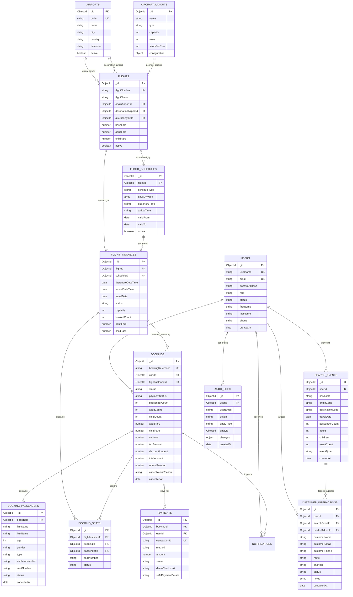
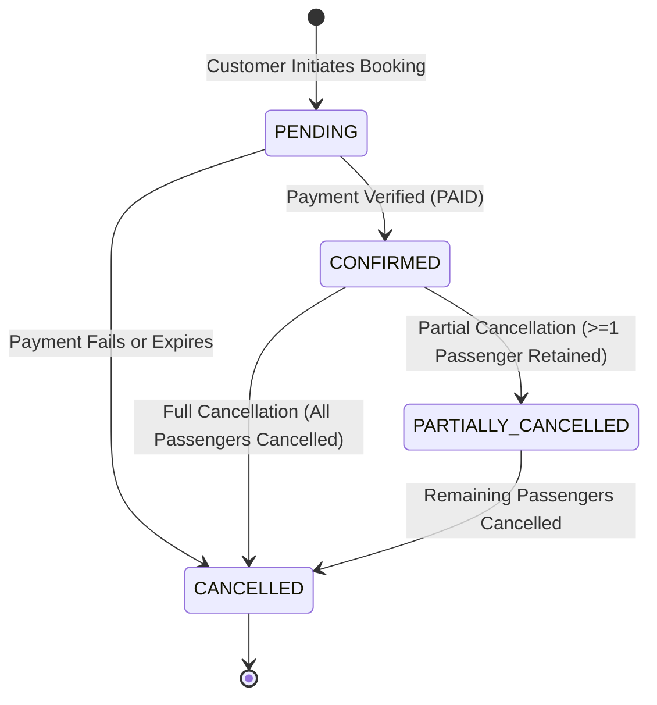
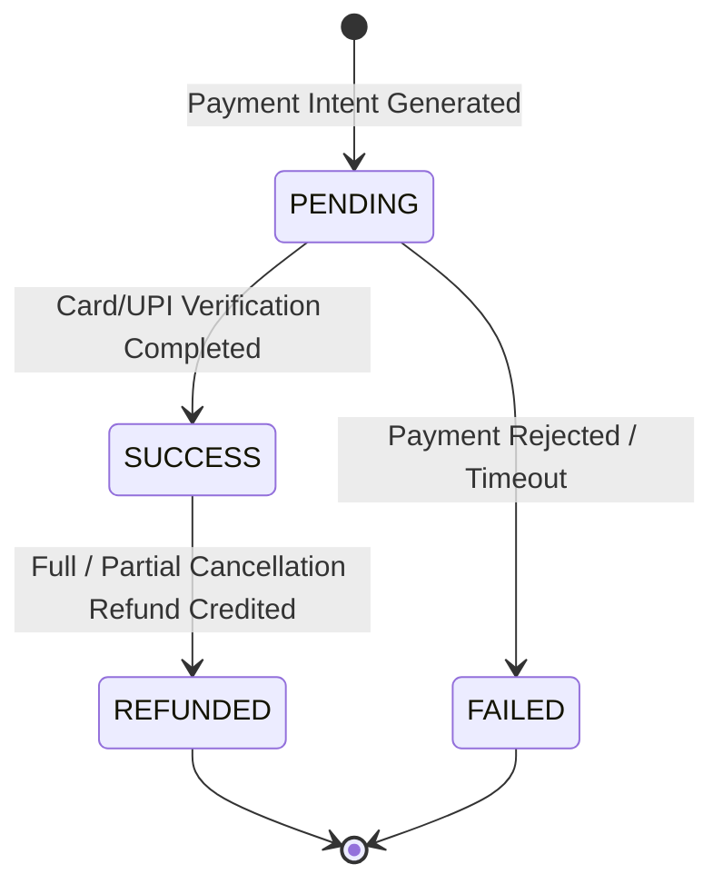
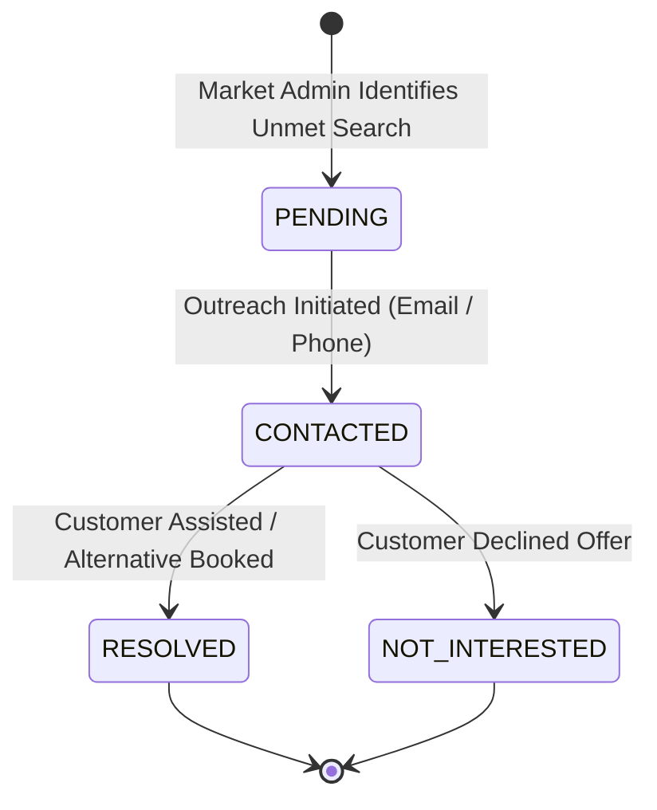

# SKYNEXA FLIGHT BOOKING ENGINE — DATABASE DESIGN & SCHEMA ARCHITECTURE

## 1. Database Overview
- **Database Engine**: MongoDB Atlas (Cloud NoSQL Document Database)
- **Database Name**: `skynexa`
- **Object Modeling**: Mongoose v8.0.3 with Schema Validation, Virtuals, Compound Indexes, and ACID Transactions.
- **Data Normalization Approach**: Hybrid normalized model with embedded snapshots. Core domain entities (`users`, `airports`, `flights`, `flightschedules`, `flightinstances`, `bookings`, `bookingpassengers`, `bookingseats`, `payments`, `searchevents`, `customerinteractions`, `auditlogs`) maintain explicit `ObjectId` foreign references. Historical immutable values (fare breakdowns, taxes, seat numbers at booking time) are preserved as embedded immutable snapshots to ensure audits remain unaffected by future price changes.

---

## 2. Mermaid Entity-Relationship (ER) Diagram

---

## 3. Entity Specifications & Collection Schemas

### 3.1 `users`
- **Purpose**: Stores customer profiles, staff accounts, and role authorization credentials.
- **Key Fields**:
  - `_id`: Primary Key (`ObjectId`)
  - `username`: Unique username handle (`String`, unique, lowercase, indexed)
  - `email`: Unique email address (`String`, unique, lowercase, indexed)
  - `passwordHash`: Bcrypt salted password hash (`String`)
  - `role`: Role discriminator (`String`, Enum: `CUSTOMER`, `SCHEDULE_ADMIN`, `MARKETING_ADMIN`, `SUPER_ADMIN`, default: `CUSTOMER`)
  - `status`: Account status (`String`, Enum: `ACTIVE`, `INACTIVE`, default: `ACTIVE`)
  - `firstName`, `lastName`, `phone`: Identity and contact metadata
  - `identityVerificationStatus`: Verification status (`NOT_VERIFIED`, `PENDING`, `VERIFIED`)
- **Indexes**:
  - `{ email: 1 }` (unique)
  - `{ username: 1 }` (unique)
  - `{ role: 1 }`

### 3.2 `airports`
- **Purpose**: Master catalog of domestic and international airport nodes.
- **Key Fields**:
  - `_id`: Primary Key (`ObjectId`)
  - `code`: 3-letter IATA code (`String`, uppercase, unique, indexed e.g., `DEL`, `BOM`, `MAA`)
  - `name`: Full airport name (`String` e.g., `Indira Gandhi International Airport`)
  - `city`: City location (`String`)
  - `country`: Country (`String`, default: `India`)
  - `timezone`: Timezone identifier (`String`, default: `Asia/Kolkata`)
  - `active`: Operational toggle (`Boolean`, default: `true`)
- **Indexes**:
  - `{ code: 1 }` (unique)
  - `{ city: 1 }`

### 3.3 `aircraftlayouts`
- **Purpose**: Physical seat layout definitions and cabin specifications.
- **Key Fields**:
  - `_id`: Primary Key (`ObjectId`)
  - `name`: Descriptive layout name (`String` e.g., `Airbus A320neo 180Y Standard`)
  - `type`: Aircraft type (`String` e.g., `A320`, `B737`, `E190`)
  - `capacity`: Total seating capacity (`Number`, min: 1)
  - `rows`: Total seat rows (`Number`)
  - `seatsPerRow`: Seats per row across aisle (`Number` e.g., 6 for 3-3 configuration)
  - `configuration`: Seat coordinate map with row letters (`A`, `B`, `C`, `D`, `E`, `F`) and exit rows

### 3.4 `flights`
- **Purpose**: Reusable master flight catalog defining commercial airline routes.
- **Key Fields**:
  - `_id`: Primary Key (`ObjectId`)
  - `flightNumber`: Commercial flight callsign (`String`, unique, uppercase e.g., `SK-101`)
  - `flightName`: Route branding name (`String` e.g., `Skynexa Express`)
  - `originAirportId`: Departure airport reference (`ObjectId` -> `airports`)
  - `destinationAirportId`: Arrival airport reference (`ObjectId` -> `airports`)
  - `aircraftLayoutId`: Aircraft specification reference (`ObjectId` -> `aircraftlayouts`)
  - `baseFare`: Default base fare in INR (`Number`, min: 0, **Super Admin Managed**)
  - `adultFare`: Default adult ticket fare (`Number`, min: 0, **Super Admin Managed**)
  - `childFare`: Default child ticket fare (`Number`, min: 0, **Super Admin Managed**)
  - `active`: Operational status flag (`Boolean`, default: `true`)
- **Indexes**:
  - `{ flightNumber: 1 }` (unique)
  - `{ originAirportId: 1, destinationAirportId: 1 }`

### 3.5 `flightschedules`
- **Purpose**: Recurring or seasonal scheduling rules created by Schedule Admins.
- **Key Fields**:
  - `_id`: Primary Key (`ObjectId`)
  - `flightId`: Flight reference (`ObjectId` -> `flights`)
  - `scheduleType`: Frequency pattern (`DAILY`, `WEEKLY`, `CUSTOM`)
  - `daysOfWeek`: Operating days array (`[Number]`, where 0=Sunday, 1=Monday... 6=Saturday)
  - `departureTime`: Fixed departure time in IST (`String` e.g., `06:00`)
  - `arrivalTime`: Fixed arrival time in IST (`String` e.g., `07:15`)
  - `validFrom`: Schedule start date (`Date`)
  - `validTo`: Schedule end date (`Date`)
  - `active`: Schedule active toggle (`Boolean`, default: `true`)
- **Indexes**:
  - `{ flightId: 1, active: 1 }`

### 3.6 `flightinstances`
- **Purpose**: Represents an actual physical flight departure on a specific date.
- **Key Fields**:
  - `_id`: Primary Key (`ObjectId`)
  - `flightId`: Flight definition reference (`ObjectId` -> `flights`)
  - `scheduleId`: Generating schedule reference (`ObjectId` -> `flightschedules`)
  - `departureDateTime`: ISO departure timestamp (`Date`, indexed)
  - `arrivalDateTime`: ISO arrival timestamp (`Date`)
  - `travelDate`: Departure calendar date normalized to midnight UTC (`Date`, indexed)
  - `status`: Flight operational status (`SCHEDULED`, `ON_TIME`, `DELAYED`, `BOARDING`, `DEPARTED`, `CANCELLED`)
  - `capacity`: Maximum available seats (`Number`)
  - `bookedCount`: Currently booked active passengers (`Number`, default: 0)
  - `adultFare`: Departure-specific adult fare snapshot (`Number`)
  - `childFare`: Departure-specific child fare snapshot (`Number`)
- **Virtual Field**:
  - `availableSeats`: Evaluated dynamically as `capacity - bookedCount`
- **Indexes**:
  - `{ flightId: 1, departureDateTime: 1 }` (unique compound index to prevent duplicate instances)
  - `{ travelDate: 1, status: 1 }`

### 3.7 `bookings`
- **Purpose**: Core commercial reservation record holding fare snapshot and booking lifecycle.
- **Key Fields**:
  - `_id`: Primary Key (`ObjectId`)
  - `bookingReference`: Unique PNR alphanumeric code (`String`, unique e.g., `SKY-2026-X8Y7Z`)
  - `userId`: Customer account reference (`ObjectId` -> `users`, indexed)
  - `flightInstanceId`: Reserved departure reference (`ObjectId` -> `flightinstances`, indexed)
  - `status`: Booking state (`PENDING`, `CONFIRMED`, `PARTIALLY_CANCELLED`, `CANCELLED`)
  - `paymentStatus`: Financial transaction state (`PENDING`, `PAID`, `FAILED`, `REFUNDED`)
  - `passengerCount`: Total active passengers (`Number`, min: 0)
  - `adultCount`: Active adult passengers (`Number`, min: 0)
  - `childCount`: Active child passengers (`Number`, min: 0)
  - `adultFare`: Preserved snapshot of adult ticket fare at booking time (`Number`)
  - `childFare`: Preserved snapshot of child ticket fare at booking time (`Number`)
  - `subtotal`: Base ticket price snapshot (`Number`)
  - `taxAmount`: Preserved 12% GST and airport development fees (`Number`)
  - `discountAmount`: Promotional discount deducted (`Number`, default: 0)
  - `totalAmount`: Net payable/paid amount (`Number`)
  - `refundAmount`: Total amount credited back following partial/complete cancellation (`Number`, default: 0)
  - `cancellationReason`: Reason recorded on cancellation (`String`)
  - `cancelledAt`: Timestamp of cancellation event (`Date`)
- **Indexes**:
  - `{ bookingReference: 1 }` (unique)
  - `{ userId: 1, createdAt: -1 }`
  - `{ flightInstanceId: 1 }`
  - `{ status: 1 }`

### 3.8 `bookingpassengers`
- **Purpose**: Individual passenger manifest records linked to a booking.
- **Key Fields**:
  - `_id`: Primary Key (`ObjectId`)
  - `bookingId`: Associated booking reference (`ObjectId` -> `bookings`, indexed)
  - `firstName`, `lastName`: Passenger legal name (`String`)
  - `age`: Age in years (`Number`)
  - `gender`: Gender (`MALE`, `FEMALE`, `OTHER`)
  - `type`: Passenger classification (`ADULT`, `CHILD`, `INFANT`)
  - `aadhaarNumber`: Government ID number (`String`)
  - `seatNumber`: Allocated seat code (`String` e.g., `12A`)
  - `status`: Individual passenger status (`CONFIRMED`, `CANCELLED`)
  - `cancelledAt`: Timestamp if passenger was cancelled (`Date`)
- **Indexes**:
  - `{ bookingId: 1 }`

### 3.9 `bookingseats`
- **Purpose**: Real-time aircraft seat allocation table preventing double bookings.
- **Key Fields**:
  - `_id`: Primary Key (`ObjectId`)
  - `flightInstanceId`: Specific departure reference (`ObjectId` -> `flightinstances`, indexed)
  - `bookingId`: Reservation reference (`ObjectId` -> `bookings`)
  - `passengerId`: Specific passenger reference (`ObjectId` -> `bookingpassengers`)
  - `seatNumber`: Seat coordinate code (`String` e.g., `14C`)
  - `status`: Seat state (`ASSIGNED`, `RELEASED`)
- **Indexes**:
  - `{ flightInstanceId: 1, seatNumber: 1, status: 1 }` (Ensures no two active bookings hold the same seat)

### 3.10 `payments`
- **Purpose**: Financial settlement and receipt verification log.
- **Key Fields**:
  - `_id`: Primary Key (`ObjectId`)
  - `bookingId`: Associated booking reference (`ObjectId` -> `bookings`, indexed)
  - `userId`: Payer reference (`ObjectId` -> `users`)
  - `transactionId`: Unique payment gateway transaction reference (`String`, unique e.g., `TXN-1729000-XYZ`)
  - `method`: Payment method (`DEMO_CARD`, `DEMO_UPI`, `CARD`, `UPI`, `NET_BANKING`)
  - `amount`: Transaction amount in INR (`Number`)
  - `status`: Payment settlement state (`PENDING`, `SUCCESS`, `FAILED`, `REFUNDED`)
  - `demoCardLast4`: Masked card identifier (`String` e.g., `4242`)
  - `safePaymentDetails`: Privacy-compliant receipt metadata (`String`)
- **Indexes**:
  - `{ transactionId: 1 }` (unique)
  - `{ bookingId: 1 }`
  - `{ status: 1 }`

### 3.11 `searchevents` (Recent Searches & Telemetry)
- **Purpose**: Search query persistence powering customer "Search Again" and Market Admin demand analytics.
- **Key Fields**:
  - `_id`: Primary Key (`ObjectId`)
  - `userId`: Authenticated customer reference if logged in (`ObjectId` -> `users`, sparse indexed)
  - `sessionId`: Guest browser session tracking ID (`String`)
  - `originCode`: Origin IATA code (`String` e.g., `DEL`)
  - `destinationCode`: Destination IATA code (`String` e.g., `BOM`)
  - `originAirportId`, `destinationAirportId`: Airport references (`ObjectId` -> `airports`)
  - `travelDate`: Requested departure date (`Date`)
  - `passengerCount`: Total passengers (`Number`)
  - `adults`: Adult passenger count (`Number`, default: 1)
  - `children`: Child passenger count (`Number`, default: 0)
  - `resultCount`: Number of matching scheduled instances found (`Number`, 0 represents unmet demand)
  - `eventType`: Event category (`SEARCH`, `SELECT`, `BOOK`)
  - `createdAt`: Search execution timestamp (`Date`, indexed)
- **Indexes**:
  - `{ userId: 1, createdAt: -1 }`
  - `{ eventType: 1, createdAt: -1 }`
  - `{ originCode: 1, destinationCode: 1 }`

### 3.12 `customerinteractions`
- **Purpose**: Staff CRM log tracking Market Admin customer outreach regarding search demand and bookings.
- **Key Fields**:
  - `_id`: Primary Key (`ObjectId`)
  - `userId`: Customer account reference (`ObjectId` -> `users`)
  - `searchEventId`: Linked search query (`ObjectId` -> `searchevents`)
  - `marketAdminId`: Staff member logging the contact (`ObjectId` -> `users`)
  - `customerName`: Customer legal name (`String`)
  - `customerEmail`: Customer email address (`String`)
  - `customerPhone`: Customer contact phone (`String`)
  - `route`: Route of interest (`String` e.g., `DEL → BOM`)
  - `channel`: Outreach medium (`EMAIL`, `PHONE`, `SMS`, `IN_APP`)
  - `status`: Interaction state (`PENDING`, `CONTACTED`, `RESOLVED`, `NOT_INTERESTED`)
  - `notes`: Staff notes and customer feedback (`String`)
  - `contactedAt`: Interaction timestamp (`Date`)
- **Indexes**:
  - `{ searchEventId: 1 }`
  - `{ status: 1 }`
  - `{ createdAt: -1 }`

### 3.13 `auditlogs`
- **Purpose**: Immutable security audit trail recording sensitive operational and financial mutations.
- **Key Fields**:
  - `_id`: Primary Key (`ObjectId`)
  - `userId`: Administrator who performed the action (`ObjectId` -> `users`)
  - `userEmail`: Administrator email address (`String`)
  - `action`: Audit action code (`UPDATE_PRICING`, `CREATE_SCHEDULE`, `CANCEL_BOOKING`, `EXPORT_CSV`)
  - `entityType`: Entity modified (`Flight`, `FlightSchedule`, `Booking`, `Payment`)
  - `entityId`: Primary key of target entity (`ObjectId`)
  - `changes`: JSON before/after state diff or configuration payload
  - `createdAt`: Immutable event timestamp (`Date`)
- **Indexes**:
  - `{ entityType: 1, entityId: 1 }`
  - `{ createdAt: -1 }`

---

## 4. State Machine & Status Transitions

### 4.1 Booking Status Lifecycle

### 4.2 Payment Status Lifecycle

### 4.3 Customer Interaction Lifecycle

---

## 5. Seat Allocation & Concurrency Guarantees
1. **Preventing Double Allocation**:
   - `BookingSeat` tracks active seats for each `flightInstanceId`.
   - Before confirming a seat assignment, a transaction verifies `{ flightInstanceId, seatNumber, status: 'ASSIGNED' }` does not exist.
2. **Cancellation & Inventory Restoration**:
   - On complete cancellation: All `BookingSeat` records for the booking are marked `RELEASED`, and `FlightInstance.bookedCount` is decremented by the cancelled passenger count.
   - On partial cancellation: Only the seats belonging to the explicitly cancelled passengers are updated to `RELEASED`. Active passengers retain their confirmed seats.
3. **Atomic Decrementing**:
   - MongoDB `$inc: { bookedCount: -count }` ensures thread-safe inventory restoration even under concurrent requests.
